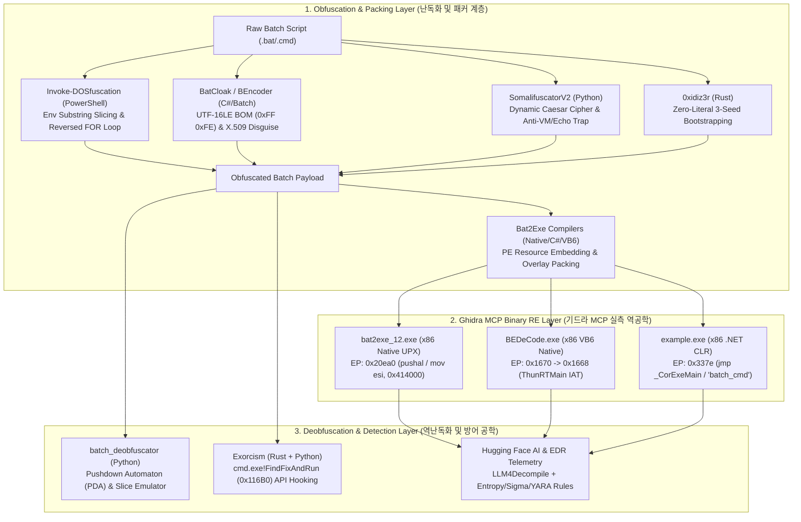

<div align="center">

<p align="center">
  <strong>🇺🇸 English</strong> · <a href="./docs/locales/ko.md">🇰🇷 한국어</a> · <a href="./docs/locales/zh-CN.md">🇨🇳 中文</a> · <a href="./docs/locales/es.md">🇪🇸 Español</a> · <a href="./docs/locales/hi.md">🇮🇳 हिन्दी</a><br />
  <a href="./docs/locales/ar.md">🇸🇦 العربية</a> · <a href="./docs/locales/pt-BR.md">🇧🇷 Português</a> · <a href="./docs/locales/ru.md">🇷🇺 Русский</a> · <a href="./docs/locales/fr.md">🇫🇷 Français</a> · <a href="./docs/locales/id.md">🇮🇩 Bahasa Indonesia</a>
</p>

<p align="center">
  <a href="https://github.com/maya-thorne/batch-obfuscation-research"></a>
</p>

# 🛡️ batch-obfuscation-research

**Windows Batch (`cmd.exe`) Obfuscation, Deobfuscation & Binary Reverse Engineering Master Archive (1990s–2026)**

[](https://github.com/maya-thorne/batch-obfuscation-research/releases)
[](./BATCH_OBFUSCATION_ARCHITECTURE_AND_CODE_ANALYSIS.md)
[](./01_배치난독화_GitHub_28종)
[](./04_탐지규칙_및_자체엔진/rules)
[](LICENSE)

<sub>Engineered &amp; Audited by **[Maya Thorne](https://github.com/maya-thorne)** · Systems &amp; Reverse Engineering Architect</sub>

</div>

---

## 📌 Executive Overview & Master Documentation

This repository is a comprehensive reverse-engineering and defensive security research archive dissecting **30 years of Windows `cmd.exe` batch file obfuscation, PE compiler wrapping (`Bat2Exe`), static AST emulation, runtime API hooking, and neural decompilation**. All nested open-source repositories have been flattened for direct source-code inspection on GitHub.

### 📚 Core Technical Whitepapers (핵심 마스터 백서 3종)

| Document | Scope & Technical Depth |
| :--- | :--- |
| 🔬 **[`BATCH_OBFUSCATION_ARCHITECTURE_AND_CODE_ANALYSIS.md`](./BATCH_OBFUSCATION_ARCHITECTURE_AND_CODE_ANALYSIS.md)** | **Ghidra MCP Binary Reverse Engineering & 7 Core Tools Source Code Dissection**:<br>• Assembly & PE Section analysis of `bat2exe_12.exe` (UPX `0x20ea0`), `BEDeCode.exe` (VB6 Native `0x1670` `ThunRTMain` & `CHRMAPSET`), and `example.exe` (.NET CLR `0x337e` `_CorExeMain` & `"batch_cmd"` resource).<br>• Line-by-line source code dissection of `Invoke-DOSfuscation`, `BatCloak`, `SomalifuscatorV2`, `0xidiz3r`, `batch_deobfuscator`, `Exorcism`, and `Bat2Exe-dehoisted`. |
| 📖 **[`BATCH_OBFUSCATION_ENCYCLOPEDIA.md`](./BATCH_OBFUSCATION_ENCYCLOPEDIA.md)** | **Master Encyclopedia (v2.0)**:<br>• `cmd.exe` 5-Stage Preprocessing Pipeline (`%VAR%` ➔ `^` Escape ➔ `!VAR!` Delayed Expansion ➔ Delimiter Normalization ➔ `CmdNode` Dispatch).<br>• Complete taxonomy of 12 obfuscation techniques & 48 open-source/AI reference catalog. |
| 🛡️ **[`BATCH_OBFUSCATION_MASTER_GUIDE.md`](./BATCH_OBFUSCATION_MASTER_GUIDE.md)** | **30-Year Evolution & Detection Engineering Guide**:<br>• Chronological evolution from 1990s MS-DOS tricks to 2026 Hugging Face LLM deobfuscation.<br>• Multi-layer forensic pipeline & production-ready **Sigma / YARA** rulesets. |

---

## 🏗️ System Architecture & Reverse Engineering Pipeline

<p align="center">
  <a href="https://github.com/maya-thorne/batch-obfuscation-research">
    
  </a>
</p>

<p align="center">
  <a href="https://github.com/maya-thorne/batch-obfuscation-research">
    
  </a>
</p>




---

## 📂 Full Repository Directory Structure (전체 디렉터리 구조)

```text
batch-obfuscation-research/
├── BATCH_OBFUSCATION_ARCHITECTURE_AND_CODE_ANALYSIS.md  # 🔬 Ghidra MCP Binary RE & 7 Core Tools Source Dissection
├── BATCH_OBFUSCATION_ENCYCLOPEDIA.md                    # 📖 Master Encyclopedia (12 Techniques & 48 References)
├── BATCH_OBFUSCATION_MASTER_GUIDE.md                    # 🛡️ 30-Year Evolution, Parser Internals & Sigma/YARA Guide
├── catalog.json                                         # 📋 Structured metadata catalog of 48 tools & datasets
├── references_index.json                                # 🔍 Deep feature & technique cross-reference index
│
├── 01_배치난독화_GitHub_28종/                             # 📥 Flattened Full Source Mirrors (41 Repositories)
│   ├── Invoke-DOSfuscation/                             # [Tier 1] Daniel Bohannon (Mandiant) Standard Framework
│   ├── Invoke-CradleCrafter/                            # [Tier 1] PowerShell/CMD Download Cradle Obfuscator
│   ├── Out-FINcodedCommand/                             # [Tier 1] FIN7 Environment Variable Slicing PoC
│   ├── assemblyline-service-batchdeobfuscator/          # [Tier 1] CybercentreCanada Official Forensic Service
│   ├── BatCloak/                                        # [Tier 1] Modern PaaS Batch Crypter & X.509 Disguise
│   ├── SomalifuscatorV2/                                # [Tier 2] Caesar Cipher, Anti-VM, Echo Trap & UTF-16 BOM
│   ├── 0xidiz3r/                                        # [Tier 2] Rust Bidirectional Zero-Literal Obfuscator
│   ├── batch_deobfuscator/                              # [Tier 3] DissectMalware Static PDA AST Emulator
│   ├── Exorcism/                                        # [Tier 3] Rust DLL Hooking on cmd.exe!FindFixAndRun
│   ├── DE-SomalifuscatorV2/                             # [Tier 3] Dedicated SomalifuscatorV2 Deobfuscator
│   ├── CMD-DeObfuscator/                                # [Tier 3] Flex Lexer-based CMD Grammar Parser
│   ├── Bat2Exe-dehoisted/                               # [Tier 4] C# WinForms Compiler, BOM Encoder & Stubs
│   ├── bat2exe-islamadel/                               # [Tier 4] Legacy Native UPX Bat2Exe Wrapper
│   ├── Batch-Encryption-DeCoder/                        # [Tier 4] VB6 Native Decoder (BEDeCode.exe) + Source
│   └── (27+ additional obfuscators, unpackers & dumpers)...
│
├── 02_HuggingFace_AI_자원/                               # 🤗 Hugging Face AI Models, Datasets & EDR Telemetry
│   ├── EDR_Telemetry_Sample/                            # Sandbox EDR malicious CMD process trees & CLI logs
│   ├── sigmaforge-detection-rules/                      # Command-line obfuscation Sigma detection collection
│   ├── cybersecurity-rules/                             # YARA & Sigma dataset (rules_dataset.jsonl)
│   ├── LLM4Decompile_Deobfuscate_ModelCard.md           # LLaMA-based neural decompilation & deobfuscation
│   ├── c_deobfuscate_mt_ModelCard.md                    # T5 Encoder-Decoder neural deobfuscation model
│   └── jfrog_obfuscation_identification_DatasetCard.md  # JFrog Token Entropy Identification (ArXiv:2510.26847)
│
├── 03_고전_및_실전_연구샘플/                               # 📜 30-Year Evolution Whitepaper & 6 PoC Batch Samples
│   ├── CLASSIC_TO_MODERN_EVOLUTION.md                   # 1990s MS-DOS to 2026 APT evolution analysis
│   ├── 07_batcloak_scrubcrypt_deep_dive.md              # 3-stage memory decryption forensic analysis
│   └── 01~06_*.bat                                      # Verified PoC samples (Slicing, Carets, Reverse Loop, WMI)
│
└── 04_탐지규칙_및_자체엔진/                               # 🚀 Custom Multi-Pass Deobfuscator & Detection Rules
    ├── deobfuscator_engine.py                           # Custom Python Multi-Pass Static Deobfuscation Engine
    ├── huggingface_models_and_datasets.md               # Transformer AI Deobfuscation Architecture Report
    ├── research_whitepapers_and_reports.md              # Mandiant & Unit 42 Threat Intelligence Synthesis
    └── rules/
        ├── sigma_batch_obfuscation.yml                  # Production Sigma rules for slicing & caret chains
        └── yara_batch_obfuscation.yar                   # Production YARA rules for BOM & inline Certutil
```

---

## 🔬 Ghidra MCP Binary Reverse Engineering Summary

| Target Binary | Architecture | Entry Point (RVA) | Key Disassembly & Structural Findings (`ghidra-re-operator`) |
| :--- | :--- | :---: | :--- |
| **`bat2exe_12.exe`**<br>([`bat2exe-islamadel`](./01_배치난독화_GitHub_28종/bat2exe-islamadel)) | x86 Native PE<br>(UPX Packed) | `0x20ea0` | • `UPX0` (`raw_size: 0x0`, `virtual_size: 0x18000`) & `UPX1` section layout.<br>• `60 (pushal)` ➔ `BE 00 40 41 00 (mov esi, 0x414000)` ➔ `8D BD 00 D0 FE FF (lea edi, [ebp-0x13000])` in-memory decompression loop before dropping batch payload to `%TEMP%`. |
| **`BEDeCode.exe`**<br>([`Batch-Encryption-DeCoder`](./01_배치난독화_GitHub_28종/Batch-Encryption-DeCoder)) | x86 Native PE<br>(VB6 Runtime) | `0x1670` | • `68 90 17 40 00 (push 0x401790)` ➔ `E8 EE FF FF FF (call 0x1668)` ➔ `FF 25 60 11 40 00 (jmp [MSVBVM60.DLL!ThunRTMain])`.<br>• Symbol `DeCodeAndOutput` at `0x2a68` cross-verified with VB6 `CHRMAPSET` / `ALPHABET` struct in `src/modules/mdlMain.bas`. |
| **`example.exe`**<br>([`Bat2Exe-dehoisted`](./01_배치난독화_GitHub_28종/Bat2Exe-dehoisted)) | x86 .NET CIL<br>(Resource Wrapper) | `0x337e` | • `FF 25 00 20 40 00 (jmp [mscoree.dll!_CorExeMain])`.<br>• Embedded resource stream `"batch_cmd"` at offset `0x06ed` (RVA `0x24ed`) extracted at runtime into hidden `ProcessStartInfo("cmd.exe")`. |

---

## 🚀 Quick Start (빠른 실행 가이드)

```bash
# 1. Run the custom Multi-Pass Static Deobfuscator Engine
python 04_탐지규칙_및_자체엔진/deobfuscator_engine.py 03_고전_및_실전_연구샘플/01_env_slicing_sample.bat output_clean.bat

# 2. Run DissectMalware / CCCS Pushdown Automaton Interpreter
python 01_배치난독화_GitHub_28종/batch_deobfuscator/batch_deobfuscator/batch_interpreter.py --file 03_고전_및_실전_연구샘플/02_caret_and_delimiters_sample.bat
```

---

## 📄 License & Open-Source Attribution

Distributed under the **MIT License**. See [`LICENSE`](LICENSE) for full legal text.

### 🏛️ Open-Source Research Attribution
This educational and defensive research archive acknowledges and studies the seminal work of the cybersecurity research community:
- **Invoke-DOSfuscation / Out-FINcodedCommand**: Daniel Bohannon (Mandiant / Apache 2.0 & BSD)
- **batch_deobfuscator**: Canadian Centre for Cyber Security (CCCS) / Assemblyline (MIT)
- **Exorcism**: Mariusz Banach / mgeeky (In-Memory `cmd.exe!FindFixAndRun` Interceptor) (MIT)
- **SomalifuscatorV2**: Somali / Anti-VM & Echo Trap Architecture (GPL-3.0 / MIT)
- **0xidiz3r**: kDot227 / Rust-based Bidirectional AST Obfuscator (MIT)
- **BatCloak / ScrubCrypt**: Mandiant FLARE & Unit 42 Threat Intelligence Research
- **Batch-Encryption-DeCoder**: s0m30n3 / VB6 P-Code Alphabet Matrix Decoder (MIT)
- **Bat2Exe-dehoisted & xorPacker**: Open-source PE compiler analysis & UPX/Overlay extraction (MIT)

*All reverse engineering, binary triaging, and decompilation materials are published strictly for authorized security auditing, threat detection engineering, and defensible defensive education.*
