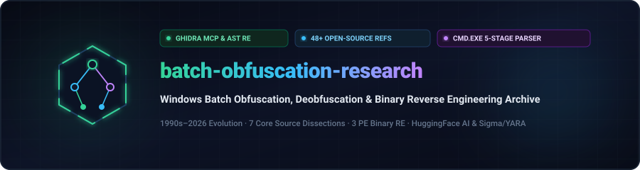
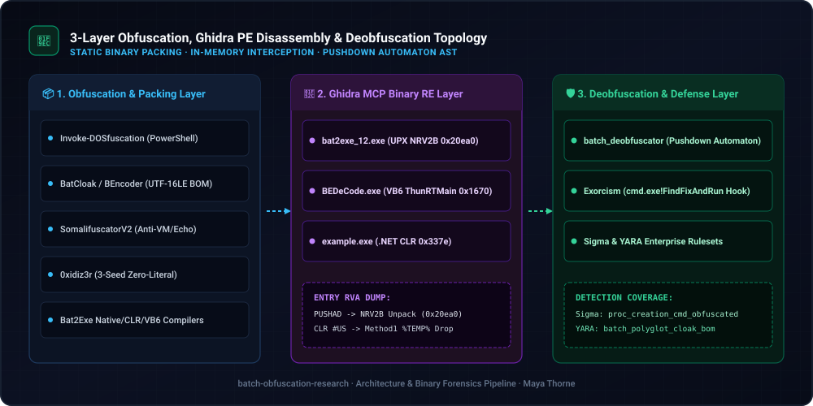
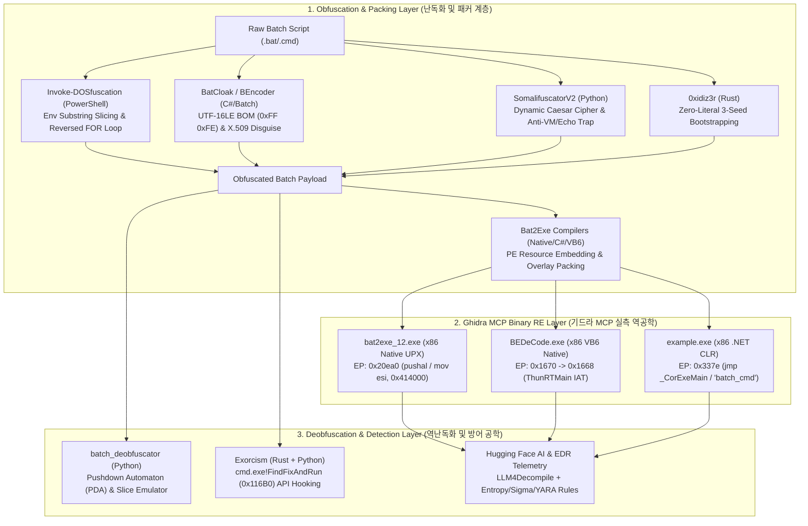

<div align="center">

<p align="center">
  <strong>🇺🇸 English</strong> · <a href="./docs/locales/ko.md">🇰🇷 한국어</a> · <a href="./docs/locales/zh-CN.md">🇨🇳 中文</a> · <a href="./docs/locales/es.md">🇪🇸 Español</a> · <a href="./docs/locales/hi.md">🇮🇳 हिन्दी</a><br />
  <a href="./docs/locales/ar.md">🇸🇦 العربية</a> · <a href="./docs/locales/pt-BR.md">🇧🇷 Português</a> · <a href="./docs/locales/ru.md">🇷🇺 Русский</a> · <a href="./docs/locales/fr.md">🇫🇷 Français</a> · <a href="./docs/locales/id.md">🇮🇩 Bahasa Indonesia</a>
</p>

<p align="center">
  <a href="https://github.com/maya-thorne/batch-obfuscation-research"></a>
</p>

# 🛡️ batch-obfuscation-research

**Windows Batch (`cmd.exe`) Obfuscation, Deobfuscation & Binary Reverse Engineering Master Archive (1990s–2026)**

[](https://github.com/maya-thorne/batch-obfuscation-research/releases)
[](./docs/whitepapers/BATCH_OBFUSCATION_ARCHITECTURE_AND_CODE_ANALYSIS.md)
[](./references/batch_corpus_28)
[](./references/detection_rules/rules)
[](LICENSE)

<sub>Engineered &amp; Audited by **[Maya Thorne](https://github.com/maya-thorne)** · Systems &amp; Reverse Engineering Architect</sub>

</div>

---

## 📌 Executive Overview & Master Documentation

This repository is a comprehensive reverse-engineering and defensive security research archive dissecting **30 years of Windows `cmd.exe` batch file obfuscation, PE compiler wrapping (`Bat2Exe`), static AST emulation, runtime API hooking, and neural decompilation**. All nested open-source repositories have been flattened for direct source-code inspection on GitHub.

### 📚 Core Technical Whitepapers (핵심 마스터 백서 3종)

<table width="100%">
  <thead>
    <tr>
      <th width="32%" align="left">📄 Document / Whitepaper</th>
      <th width="68%" align="left">🔬 Scope &amp; Technical Depth</th>
    </tr>
  </thead>
  <tbody>
    <tr>
      <td>
        🔬 <strong><a href="./docs/whitepapers/BATCH_OBFUSCATION_ARCHITECTURE_AND_CODE_ANALYSIS.md">Architecture &amp; Code Analysis</a></strong><br>
        <code>BATCH_OBFUSCATION_<wbr>ARCHITECTURE_<wbr>AND_CODE_ANALYSIS.md</code>
      </td>
      <td>
        <strong>Ghidra MCP Binary Reverse Engineering &amp; 7 Core Tools Source Dissection</strong>:<br>
        • Assembly &amp; PE Section analysis of <code>bat2exe_12.exe</code> (UPX <code>0x20ea0</code>), <code>BEDeCode.exe</code> (VB6 Native <code>0x1670 ThunRTMain</code> &amp; <code>CHRMAPSET</code>), and <code>example.exe</code> (.NET CLR <code>0x337e _CorExeMain</code> &amp; <code>"batch_cmd"</code> resource).<br>
        • Line-by-line source code dissection of <code>Invoke-DOSfuscation</code>, <code>BatCloak</code>, <code>SomalifuscatorV2</code>, <code>0xidiz3r</code>, <code>batch_deobfuscator</code>, <code>Exorcism</code>, and <code>Bat2Exe-dehoisted</code>.
      </td>
    </tr>
    <tr>
      <td>
        📖 <strong><a href="./docs/whitepapers/BATCH_OBFUSCATION_ENCYCLOPEDIA.md">Master Encyclopedia (v2.0)</a></strong><br>
        <code>BATCH_OBFUSCATION_<wbr>ENCYCLOPEDIA.md</code>
      </td>
      <td>
        <strong>Master Encyclopedia (v2.0)</strong>:<br>
        • <code>cmd.exe</code> 5-Stage Preprocessing Pipeline (<code>%VAR%</code> ➔ <code>^</code> Escape ➔ <code>!VAR!</code> Delayed Expansion ➔ Delimiter Normalization ➔ <code>CmdNode</code> Dispatch).<br>
        • Complete taxonomy of 12 obfuscation techniques &amp; 48 open-source/AI reference catalog.
      </td>
    </tr>
    <tr>
      <td>
        🛡️ <strong><a href="./docs/whitepapers/BATCH_OBFUSCATION_MASTER_GUIDE.md">30-Year Evolution &amp; Guide</a></strong><br>
        <code>BATCH_OBFUSCATION_<wbr>MASTER_GUIDE.md</code>
      </td>
      <td>
        <strong>30-Year Evolution &amp; Detection Engineering Guide</strong>:<br>
        • Chronological evolution from 1990s MS-DOS tricks to 2026 Hugging Face LLM deobfuscation.<br>
        • Multi-layer forensic pipeline &amp; production-ready <strong>Sigma / YARA</strong> rulesets.
      </td>
    </tr>
  </tbody>
</table>

---

## 🏗️ System Architecture & Reverse Engineering Pipeline

<p align="center">
  <a href="https://github.com/maya-thorne/batch-obfuscation-research">
    
  </a>
</p>

<p align="center">
  <a href="https://github.com/maya-thorne/batch-obfuscation-research">
    
  </a>
</p>


<details>
<summary><b>📊 Text-based Mermaid Pipeline Flowchart (Click to Expand / Collapse)</b></summary>
<br>



</details>

---

## 📂 Full Repository Directory Structure (전체 디렉터리 구조)

<details open>
<summary><b>📂 Full Repository Directory Tree (Click to Collapse / Expand)</b></summary>
<br>

```text
batch-obfuscation-research/
├── docs/                                                # 📁 Master Whitepapers, Locales & Vector Diagrams
│   ├── assets/locales/                                  # 10 Locales SVG Banners, Architecture & AST Diagrams
│   ├── locales/                                         # 10 Language Full Markdown Mirrors (ko, zh-CN, es, etc.)
│   └── whitepapers/                                     # 6 Core Deep Reverse Engineering & Evolution Whitepapers
│       ├── BATCH_OBFUSCATION_ARCHITECTURE_AND_CODE_ANALYSIS.md
│       ├── BATCH_OBFUSCATION_ENCYCLOPEDIA.md
│       ├── BATCH_OBFUSCATION_MASTER_GUIDE.md
│       ├── BATCH_OBFUSCATION_DEEP_REVERSE_ENGINEERING_ANALYSIS.md
│       ├── DEEP_REVERSE_ENGINEERING_AND_SOURCE_ANALYSIS.md
│       └── GHIDRA_BINARY_RE_AND_DEOBFUSCATOR_ENGINE_ANALYSIS.md
│
├── references/                                          # 📁 100% English Open-Source Mirrors & AI Resources
│   ├── batch_corpus_28/                                 # 41 Flattened Obfuscators, Unpackers & Compilers
│   │   ├── Invoke-DOSfuscation/                         # [Tier 1] Daniel Bohannon (Mandiant) Standard Framework
│   │   ├── Invoke-CradleCrafter/                        # [Tier 1] PowerShell/CMD Download Cradle Obfuscator
│   │   ├── Out-FINcodedCommand/                         # [Tier 1] FIN7 Environment Variable Slicing PoC
│   │   ├── assemblyline-service-batchdeobfuscator/      # [Tier 1] CybercentreCanada Official Forensic Service
│   │   ├── BatCloak/                                    # [Tier 1] Modern PaaS Batch Crypter & X.509 Disguise
│   │   ├── SomalifuscatorV2/                            # [Tier 2] Caesar Cipher, Anti-VM, Echo Trap & UTF-16 BOM
│   │   ├── 0xidiz3r/                                    # [Tier 2] Rust Bidirectional Zero-Literal Obfuscator
│   │   ├── batch_deobfuscator/                          # [Tier 3] DissectMalware Static PDA AST Emulator
│   │   ├── Exorcism/                                    # [Tier 3] Rust DLL Hooking on cmd.exe!FindFixAndRun
│   │   ├── Bat2Exe-dehoisted/                           # [Tier 4] C# WinForms Compiler, BOM Encoder & Stubs
│   │   ├── bat2exe-islamadel/                           # [Tier 4] Legacy Native UPX Bat2Exe Wrapper
│   │   └── Batch-Encryption-DeCoder/                    # [Tier 4] VB6 Native Decoder (BEDeCode.exe) + Source
│   ├── huggingface_ai/                                  # 🤗 Hugging Face AI Models, Datasets & EDR Telemetry
│   │   ├── EDR_Telemetry_Sample/                        # Sandbox EDR malicious CMD process trees & CLI logs
│   │   ├── sigmaforge-detection-rules/                  # Command-line obfuscation Sigma detection collection
│   │   └── cybersecurity-rules/                         # YARA & Sigma dataset (rules_dataset.jsonl)
│   ├── classic_samples/                                 # 📜 30-Year Evolution Whitepaper & 6 PoC Batch Samples
│   │   ├── CLASSIC_TO_MODERN_EVOLUTION.md               # 1990s MS-DOS to 2026 APT evolution analysis
│   │   ├── 07_batcloak_scrubcrypt_deep_dive.md          # 3-stage memory decryption forensic analysis
│   │   └── 01~06_*.bat                                  # Verified PoC samples (Slicing, Carets, Reverse Loop, WMI)
│   └── detection_rules/                                 # 🚀 Production Sigma & YARA Rulesets
│       └── rules/                                       # sigma_batch_obfuscation.yml & yara_batch_obfuscation.yar
│
├── src/                                                 # ⚙️ Core Executable Python Engines
│   └── deobfuscator_engine.py                           # Multi-Pass Static Pushdown Automaton AST Engine
├── memory/                                              # 🧠 Task Context & Feedback Audit Checklists
├── .gitignore                                           # 🛡️ Clean Environment & Artifact Exclusion
├── LICENSE                                              # 📜 Maya Thorne Systems & Security Research License (MT-SRL)
└── README.md                                            # 🌟 First-Viewport Hero Showcase (7 Root Items)
```

</details>

---

## 🔬 Ghidra MCP Binary Reverse Engineering Summary

<details open>
<summary><b>🔬 Ghidra MCP Disassembly & Structural Details (Click to Collapse / Expand)</b></summary>
<br>

<table width="100%">
  <thead>
    <tr>
      <th width="24%" align="left">🎯 Target Binary</th>
      <th width="16%" align="left">🏗️ Architecture</th>
      <th width="14%" align="center">📍 Entry Point</th>
      <th width="46%" align="left">🔬 Key Disassembly &amp; Structural Findings (<code>ghidra-re-operator</code>)</th>
    </tr>
  </thead>
  <tbody>
    <tr>
      <td>
        <strong><code>bat2exe_12.exe</code></strong><br>
        <small>(<a href="./references/batch_corpus_28/bat2exe-islamadel"><code>bat2exe-islamadel</code></a>)</small>
      </td>
      <td>x86 Native PE<br><sub>(UPX Packed)</sub></td>
      <td align="center"><code>0x20ea0</code></td>
      <td>
        • <code>UPX0</code> (<code>raw: 0x0</code>, <code>vsize: 0x18000</code>) &amp; <code>UPX1</code> section layout.<br>
        • <code>60 (pushal)</code> ➔ <code>BE 00 40 41 00 (mov esi, 0x414000)</code> ➔ <code>8D BD 00 D0 FE FF (lea edi, [ebp-0x13000])</code> in-memory decompression loop before dropping batch payload to <code>%TEMP%</code>.
      </td>
    </tr>
    <tr>
      <td>
        <strong><code>BEDeCode.exe</code></strong><br>
        <small>(<a href="./references/batch_corpus_28/Batch-Encryption-DeCoder"><code>Batch-Encryption-DeCoder</code></a>)</small>
      </td>
      <td>x86 Native PE<br><sub>(VB6 Runtime)</sub></td>
      <td align="center"><code>0x1670</code></td>
      <td>
        • <code>68 90 17 40 00 (push 0x401790)</code> ➔ <code>E8 EE FF FF FF (call 0x1668)</code> ➔ <code>FF 25 60 11 40 00 (jmp [MSVBVM60.DLL!ThunRTMain])</code>.<br>
        • Symbol <code>DeCodeAndOutput</code> at <code>0x2a68</code> cross-verified with VB6 <code>CHRMAPSET</code> / <code>ALPHABET</code> struct in <code>src/modules/mdlMain.bas</code>.
      </td>
    </tr>
    <tr>
      <td>
        <strong><code>example.exe</code></strong><br>
        <small>(<a href="./references/batch_corpus_28/Bat2Exe-dehoisted"><code>Bat2Exe-dehoisted</code></a>)</small>
      </td>
      <td>x86 .NET CIL<br><sub>(Resource Wrapper)</sub></td>
      <td align="center"><code>0x337e</code></td>
      <td>
        • <code>FF 25 00 20 40 00 (jmp [mscoree.dll!_CorExeMain])</code>.<br>
        • Embedded resource stream <code>"batch_cmd"</code> at offset <code>0x06ed</code> (RVA <code>0x24ed</code>) extracted at runtime into hidden <code>ProcessStartInfo("cmd.exe")</code>.
      </td>
    </tr>
  </tbody>
</table>

</details>

---

## 🚀 Quick Start (빠른 실행 가이드)

```bash
# 1. Run the custom Multi-Pass Static Deobfuscator Engine
python src/deobfuscator_engine.py references/classic_samples/01_env_slicing_sample.bat output_clean.bat

# 2. Run DissectMalware / CCCS Pushdown Automaton Interpreter
python references/batch_corpus_28/batch_deobfuscator/batch_deobfuscator/batch_interpreter.py --file references/classic_samples/02_caret_and_delimiters_sample.bat
```

---

## 📄 License & Open-Source Attribution

Distributed under the **Maya Thorne Systems & Security Research License (MT-SRL)**. See [`LICENSE`](LICENSE) for full legal text.

<details>
<summary><b>🏛️ Open-Source Research Attribution & Credits (Click to Expand / Collapse)</b></summary>
<br>

This educational and defensive research archive acknowledges and studies the seminal work of the cybersecurity research community:
- **Invoke-DOSfuscation / Out-FINcodedCommand**: Daniel Bohannon (Mandiant / Apache 2.0 & BSD)
- **batch_deobfuscator**: Canadian Centre for Cyber Security (CCCS) / Assemblyline (MIT)
- **Exorcism**: Mariusz Banach / mgeeky (In-Memory `cmd.exe!FindFixAndRun` Interceptor) (MIT)
- **SomalifuscatorV2**: Somali / Anti-VM & Echo Trap Architecture (GPL-3.0 / MIT)
- **0xidiz3r**: kDot227 / Rust-based Bidirectional AST Obfuscator (MIT)
- **BatCloak / ScrubCrypt**: Mandiant FLARE & Unit 42 Threat Intelligence Research
- **Batch-Encryption-DeCoder**: s0m30n3 / VB6 P-Code Alphabet Matrix Decoder (MIT)
- **Bat2Exe-dehoisted & xorPacker**: Open-source PE compiler analysis & UPX/Overlay extraction (MIT)

*All reverse engineering, binary triaging, and decompilation materials are published strictly for authorized security auditing, threat detection engineering, and defensible defensive education.*

</details>

