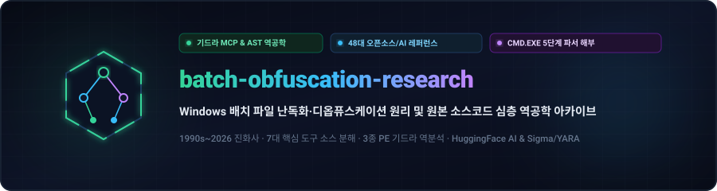
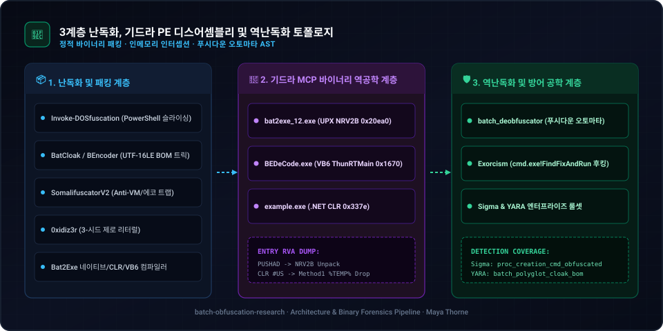
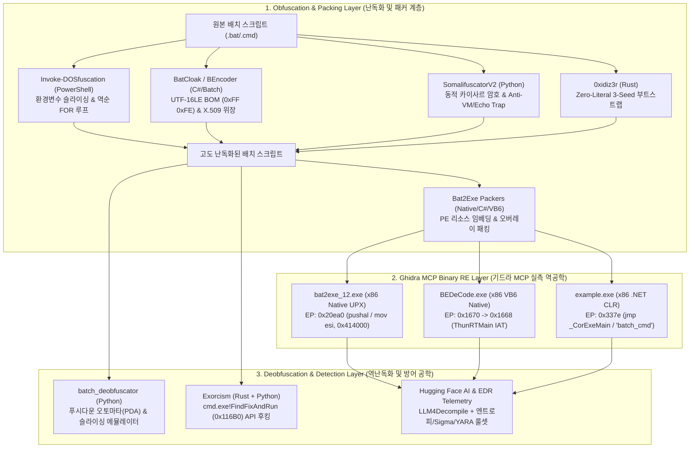

  <a href="../../README.md">🇺🇸 English</a> · <strong>🇰🇷 한국어</strong> · <a href="./zh-CN.md">🇨🇳 中文</a> · <a href="./es.md">🇪🇸 Español</a> · <a href="./hi.md">🇮🇳 हिन्दी</a> 
  <a href="./ar.md">🇸🇦 العربية</a> · <a href="./pt-BR.md">🇧🇷 Português</a> · <a href="./ru.md">🇷🇺 Русский</a> · <a href="./fr.md">🇫🇷 Français</a> · <a href="./id.md">🇮🇩 Bahasa Indonesia</a>

  

# 🛡️ batch-obfuscation-research

**Windows 배치 파일(`cmd.exe`) 난독화·디옵퓨스케이션 원리 및 원본 소스코드 심층 역공학 아카이브 (1990s–2026)**

설계 및 역공학 감사: **[Maya Thorne](https://github.com/maya-thorne)** · 시스템 &amp; 리버스 엔지니어링 아키텍트

---

## 📌 아카이브 개요 및 3대 핵심 마스터 백서

본 저장소는 지난 30년간 진화해 온 **Windows `cmd.exe` 배치 스크립트 난독화, 실행 파일 패킹(`Bat2Exe`), 정적 푸시다운 오토마타(PDA) 에뮬레이션, 런타임 API 후킹(`Exorcism`), 그리고 Hugging Face 트랜스포머 신경망 역난독화 기법**을 원본 소스코드와 어셈블리 레벨에서 전수 해부한 통합 연구 아카이브입니다.

| 마스터 문서 | 수록 내용 및 기술적 깊이 |
| :--- | :--- |
| 🔬 **[`BATCH_OBFUSCATION_ARCHITECTURE_AND_CODE_ANALYSIS.md`](../whitepapers/BATCH_OBFUSCATION_ARCHITECTURE_AND_CODE_ANALYSIS.md)** | **기드라 MCP 바이너리 역공학 & 7대 핵심 도구 원본 소스코드 분해 백서**: • `bat2exe_12.exe` (UPX 스텁 `0x20ea0`), `BEDeCode.exe` (VB6 네이티브 `0x1670` `ThunRTMain` & `CHRMAPSET`), `example.exe` (.NET CLR `0x337e` `_CorExeMain` & `"batch_cmd"` 리소스) 실측 디스어셈블리. • `Invoke-DOSfuscation`, `BatCloak`, `SomalifuscatorV2`, `0xidiz3r`, `batch_deobfuscator`, `Exorcism`, `Bat2Exe-dehoisted` 원본 코드 라인별 분해. |
| 📖 **[`BATCH_OBFUSCATION_ENCYCLOPEDIA.md`](../whitepapers/BATCH_OBFUSCATION_ENCYCLOPEDIA.md)** | **배치 난독화 종합 대백과사전 (v2.0)**: • `cmd.exe` 5단계 파싱 파이프라인(`%VAR%` ➔ `^` 이스케이프 ➔ `!VAR!` 지연 확장 ➔ 구분자 정규화 ➔ `CmdNode` 실행) 완벽 도식화. • 12대 핵심 난독화 기법 택소노미 및 48개 오픈소스/AI 데이터셋 전수 카탈로그. |
| 🛡️ **[`BATCH_OBFUSCATION_MASTER_GUIDE.md`](../whitepapers/BATCH_OBFUSCATION_MASTER_GUIDE.md)** | **30년 진화사 및 탐지 엔지니어링 마스터 가이드**: • 1990년대 고전 MS-DOS 기법부터 2026년 최신 AI 역난독화까지의 연대기. • 정적 ➔ 동적 ➔ AI 다계층 포렌식 파이프라인 및 프로덕션급 **Sigma / YARA** 탐지 룰셋. |

---

## 🏗️ 전체 아키텍처 및 역공학 파이프라인

  

  

---

## 📂 디렉터리 구성 (Repository Layout)

- 📁 **[`references/batch_corpus_28/`](../../references/batch_corpus_28)** — 중첩 `.git`이 평탄화(Flatten)되어 GitHub 웹에서 즉시 열람 가능한 41개 오픈소스 난독화기·디옵퓨스케이터·패커 원본 코드 트리.
- 📁 **[`references/huggingface_ai/`](../../references/huggingface_ai)** — `LLM4Decompile-SFT-Deobfuscate`, `c-deobfuscate-mt`, JFrog 토큰 엔트로피 식별 데이터셋(ArXiv:2510.26847), EDR 텔레메트리 및 SigmaForge 룰셋.
- 📁 **[`references/classic_samples/`](../../references/classic_samples)** — 30년 진화사 백서(`CLASSIC_TO_MODERN_EVOLUTION.md`), BatCloak/ScrubCrypt 3단계 메모리 복호화 심층 분석서 및 6종 실증 샘플.
- 📁 **[`references/detection_rules/`](../../references/detection_rules)** — 자체 개발 파이썬 다중 패스 정적 디옵퓨스케이터(`deobfuscator_engine.py`), Mandiant/Unit 42 위협 인텔리전스 백서, Sigma 및 YARA 탐지 룰.

---

## 📄 라이선스

본 프로젝트는 **Maya Thorne Systems & Security Research License (MT-SRL)** 하에 배포됩니다. 자세한 내용은 [`LICENSE`](../../LICENSE) 파일을 참조하십시오.
