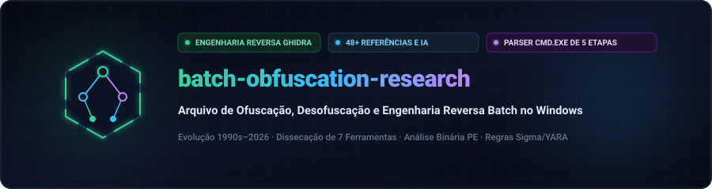
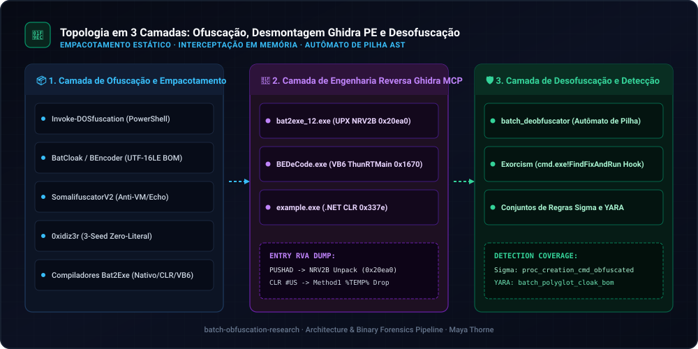
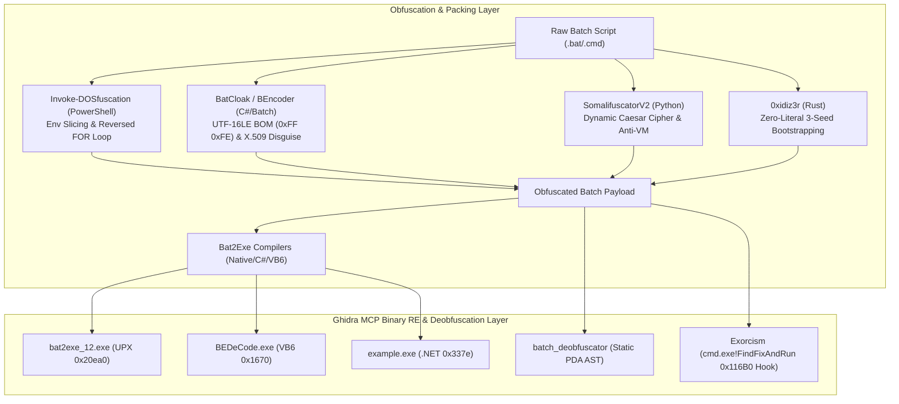

  <a href="../../README.md">🇺🇸 English</a> · <a href="./ko.md">🇰🇷 한국어</a> · <a href="./zh-CN.md">🇨🇳 中文</a> · <a href="./es.md">🇪🇸 Español</a> · <a href="./hi.md">🇮🇳 हिन्दी</a> 
  <a href="./ar.md">🇸🇦 العربية</a> · <strong>🇧🇷 Português</strong> · <a href="./ru.md">🇷🇺 Русский</a> · <a href="./fr.md">🇫🇷 Français</a> · <a href="./id.md">🇮🇩 Bahasa Indonesia</a>

  

# 🛡️ batch-obfuscation-research

**Arquivo de Ofuscação, Desofuscação e Engenharia Reversa Batch no Windows**

Engineered &amp; Audited by **[Maya Thorne](https://github.com/maya-thorne)** · Systems &amp; Reverse Engineering Research

---

## 📚 Master Technical Documentation (핵심 분석 백서 바로가기)

1. 🔬 **[BATCH_OBFUSCATION_ARCHITECTURE_AND_CODE_ANALYSIS.md](../../BATCH_OBFUSCATION_ARCHITECTURE_AND_CODE_ANALYSIS.md)**
   - **Ghidra MCP PE Binary Reverse Engineering**: `bat2exe_12.exe` (UPX Native Stub `0x20ea0`), `BEDeCode.exe` (VB6 Native `0x1670` `ThunRTMain` & `CHRMAPSET`), `example.exe` (.NET CLR `0x337e` `_CorExeMain` & `"batch_cmd"` resource).
   - **7 Core Tools Source Code Dissection**: `Invoke-DOSfuscation`, `BatCloak`, `SomalifuscatorV2`, `0xidiz3r`, `batch_deobfuscator` (Pushdown Automaton), `Exorcism` (`cmd.exe!FindFixAndRun` API Hooking), `Bat2Exe-dehoisted`.
2. 📖 **[BATCH_OBFUSCATION_ENCYCLOPEDIA.md](../../BATCH_OBFUSCATION_ENCYCLOPEDIA.md)**
   - `cmd.exe` 5-Stage Parser Internals, 12 Obfuscation Techniques Taxonomy, 48 Open-Source & Hugging Face Reference Matrix.
3. 🛡️ **[BATCH_OBFUSCATION_MASTER_GUIDE.md](../../BATCH_OBFUSCATION_MASTER_GUIDE.md)**
   - 30-Year Evolution Timeline (1990s MS-DOS to 2026 AI/LLM Deobfuscation), Multi-Layer Forensic Pipeline, Sigma & YARA Rules.

---

## 🏗️ Architecture & Reverse Engineering Pipeline

  

  

---

## 📂 Repository Directory Structure

- 📁 [`01_배치난독화_GitHub_28종/`](../../01_배치난독화_GitHub_28종) — Flattened full source code trees of 28+ open-source obfuscators, deobfuscators, runtime hookers, and compilers.
- 📁 [`02_HuggingFace_AI_자원/`](../../02_HuggingFace_AI_자원) — `LLM4Decompile-SFT-Deobfuscate`, `c-deobfuscate-mt`, JFrog Token Entropy Dataset (ArXiv:2510.26847), EDR Telemetry & SigmaForge datasets.
- 📁 [`03_고전_및_실전_연구샘플/`](../../03_고전_및_실전_연구샘플) — 30-Year Evolution Whitepaper, BatCloak/ScrubCrypt 3-stage forensic deep dive, and 6 PoC batch samples.
- 📁 [`04_탐지규칙_및_자체엔진/`](../../04_탐지규칙_및_자체엔진) — Custom Python Multi-Pass Static Deobfuscator (`deobfuscator_engine.py`), Mandiant/Unit 42 whitepaper analysis, and production Sigma/YARA rules.
